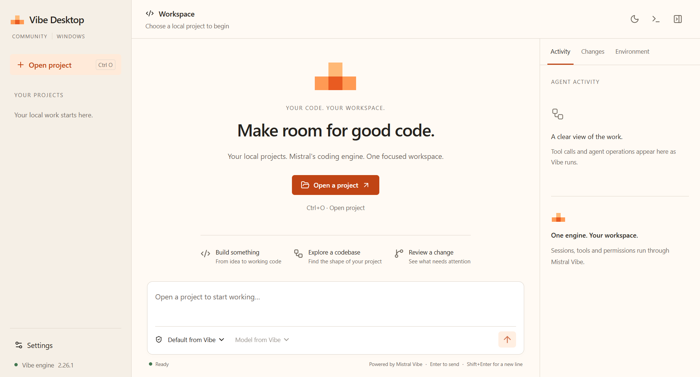

# Vibe Desktop

**Your local projects. Mistral's coding engine. One focused Windows workspace.**

Vibe Desktop is a free, open-source community client for Mistral Vibe. Open a
local project, start or continue a conversation, follow the agent's work and
follow file operations in a desktop workspace. The official Vibe app server runs
the agent, tools, permissions, session history, MCP and skills.

This is an independent project, unaffiliated with Mistral AI.



## What works today

- A real Windows x64 desktop app with light, dark and system themes.
- Local project navigation and Vibe's persisted session catalogue.
- Streaming Markdown, tool effects, approvals and user questions.
- Prompt steering, interruption and resume through the official engine.
- Agent and model selection from the configured Vibe runtime.
- Project shell and visible subagent activity.
- A packaged upstream backend, reproducible build scripts and Windows CI.

The first version targets local Vibe Code. Hosted Work/Chat, account browser
sign-in and cloud teleport remain upstream workflows. The client shares Vibe's
configuration and credentials rather than creating a separate account system.
Vibe 2.26.1's default Unified Harness does not expose the review API yet. The
Changes panel reports this explicitly; file operations remain visible in Activity.

## Run from source

Use Windows x64, Node.js 24+, Python 3.12 x64 and
[uv](https://docs.astral.sh/uv/getting-started/installation/).

```powershell
git clone https://github.com/maikolsiragusaa/mistral-vibe-desktop.git
cd mistral-vibe-desktop
npm ci
node node_modules/electron/install.js
./scripts/install-backend.ps1
npm start
```

Open **Settings** to check the engine connection. Use credentials already
configured with Vibe, or paste a Mistral API key and select **Save with Vibe**.
Vibe stores the key through its credential service; the desktop retains none.
Model use follows your Mistral plan or provider's billing.

Open a folder with **Open project** or **Ctrl+O**. When Vibe finds project
configuration, review its trust request. Describe the outcome in the composer,
then press Enter or Ctrl+Enter. Shift+Enter adds a new line; Escape interrupts
an active turn. Select a saved conversation in the project rail to continue it.

## Build a Windows package

```powershell
./scripts/build-backend.ps1
npm run package
```

The local NSIS installer appears under `out/`. It contains the official
`mistral-vibe==2.26.1` app server and its Python/native runtime, so an installed
app needs no separate Python or uv installation. Git and a shell supported by
Vibe are still workspace tools; the app does not install or replace them.

Builds are unsigned until a signing identity is configured. These commands
produce local artifacts and do not publish a release. The
[validation record](docs/validation.md) names the checks actually executed and
the remaining Windows 11 installation checks.

## Test

```powershell
npm run build
npm test
npm run test:ui
```

Backend tests run the real Vibe engine against a loopback model fixture. The
fixture exists only under tests and does not call a paid API. The desktop UI
test launches Electron, opens a disposable local project, streams a turn,
resumes it and runs a shell command. It also captures the actual light and dark
interfaces. To test the frozen backend:

```powershell
$env:VIBE_TEST_SERVER = "$PWD/.runtime/backend/vibe-app-server/vibe-app-server.exe"
npm run test:ui
```

## Understand the project

- [Research and desktop chronology](docs/research.md): source evidence, dates,
  existing products and the feature gap matrix.
- [Architecture](docs/architecture.md): ownership, protocol, stack choice and
  the Windows feasibility gate.
- [Architecture references](docs/references.md): lessons from OpenCode and
  DeepSeek Harness.
- [Design](docs/design.md): Mistral-informed visual and writing direction,
  plus the original layout preview.
- [Contributing](CONTRIBUTING.md): boundaries and the development workflow.
- [Backlog](docs/backlog.md): the next useful increments.

## License

Apache-2.0. See [LICENSE](LICENSE), [NOTICE](NOTICE) and
[third-party notices](THIRD_PARTY_NOTICES.md). Mistral's name and brand assets
remain its property. The stepped signal mark is original to this project.
