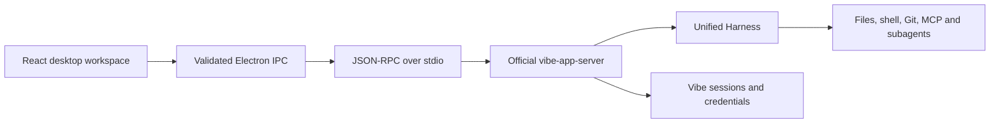

# Vibe Desktop architecture

## Decision

Build a Windows desktop delivery surface for the official Mistral Vibe app
server. Ship one Electron client and the unmodified upstream engine. The
desktop owns windows, navigation, keyboard interaction and rendering. Vibe owns
every operation that changes agent execution, workspace trust or durable
session state.

The client keeps one owned app-server process per attached root session,
with a four-connection cap. Switching to an attached tab reads its canonical
state without stopping the other turn. The pool routes session RPCs to their
owner and allows read-only child history through the parent owner. Pin/archive
are host metadata operations, authorized only for listed sessions in selected
roots. Lease subscriptions identify other clients without exposing unrelated
session IDs.

The feasibility gate passed on Windows on 12 October 2026: the published
`mistral-vibe==2.26.1` wheel installs with Python 3.12 and its native Unified
Harness. The real stdio process accepts initialization, setup, session listing,
workspace trust inspection, session creation, runtime inspection and shutdown.
The probe used an isolated Vibe home and a local provider without model calls.
An independent credential-free probe returned the expected `unauthorized`
error for the Mistral provider.

## Why this product

The public Vibe source already contains desktop session and worktree support.
That is a reason to integrate the engine closely. It is not evidence of a
downloadable Windows graphical client. This project contributes an inspectable
local Windows delivery surface, a packaged backend and protocol conformance
tests. VibeZ serves a different workflow: it wraps the hosted Vibe website.
The evidence and desktop chronology live in [Research](research.md).

## Boundary

The renderer displays the public session projection. Streaming patches update
that projection; they do not reconstruct the engine. A missing event triggers
a canonical `session/read`. A restart resumes saved history through
`session/resume`. The client never reads private session journals.

The app stores only presentation preferences and recently opened project paths.
It does not persist prompts, tool results, API keys or a second session index.
Credentials are passed directly to `setup/store-credential`; upstream keyring
storage and its documented fallback retain custody.

Drafts and attachment previews live in session-keyed memory. They survive an
owned backend restart in the running desktop, but are not a second durable
conversation store. Public history and the native turn queue stay with Vibe.

Management controls open in a modal window over the retained conversation.
Git and management code are separate chunks loaded on demand. The original
pixel companion uses finite animations and obeys both the app motion preference
and the system reduced-motion preference.

Git inspection and explicit stage/unstage/commit use a small local Git service,
separate from harness review. Paths are canonicalized under the selected
repository; traversal, `.git` access and escaping links are rejected. Output
and diff sizes are bounded. PR integration uses installed `gh` authentication,
and creation requires an explicit action plus an already published,
synchronized branch. The desktop never pushes automatically.

Browser sign-in uses a project-owned JSON-lines bridge to upstream
`AcpAuthController.authenticate("browser-auth-delegated", ...)`. The controller
owns PKCE, delegated-flow state and credential persistence. The helper returns
whitelisted status/persistence metadata; the main process validates and opens
the official sign-in URL. The frozen executable has a `--desktop-auth` launcher
mode. This adapter does not start an ACP server.

Quota pages use a separate sandboxed BrowserWindow with no preload, no Node
integration and no trusted desktop IPC. Only fixed Mistral HTTPS entry points
can be requested. The isolated persistent cookie partition belongs to those
pages; account credentials and page contents are never read by the renderer.

## Alternatives

| Option                     | Decision                           | Reason                                                                                                                          |
| -------------------------- | ---------------------------------- | ------------------------------------------------------------------------------------------------------------------------------- |
| Official app-server client | **Adopt**                          | Carries Vibe's sessions, reviews, worktrees, setup and typed callbacks through one boundary.                                    |
| ACP client                 | Keep as an interoperability option | Excellent for editor integration; the richer Vibe-specific desktop resources already exist in the app server.                   |
| Controlled harness fork    | Skip                               | No engine gap justifies owning a fork.                                                                                          |
| Independent harness        | Skip                               | Would duplicate the strongest part of the ecosystem.                                                                            |
| Electron                   | **Adopt**                          | A complete Windows build and test path is available in this environment. Chromium gives predictable rendering.                  |
| Tauri 2                    | Revisit with measurements          | Smaller runtime, but adds Rust/MSVC/WebView2 deployment requirements. A measured footprint problem can justify migration later. |

Electron's bundled browser costs more disk and memory than a system WebView.
The choice prioritizes a reproducible Windows artifact and a stable rendering
surface. The backend protocol remains independent of Electron.

## Protocol contract

Target upstream **2.26.1**, commit
[`4ae5c5955da8e761318916bdb1a7f46f0b50c7d0`](https://github.com/mistralai/mistral-vibe/commit/4ae5c5955da8e761318916bdb1a7f46f0b50c7d0).
Send strict camel-case requests and tolerate additive response fields. The
actual initialize response reports identity and process ID; it does not expose
a method catalogue. Optional resources therefore handle `method_not_found` and
`not_implemented` explicitly.

The protocol uses newline-delimited JSON on stdout. Logs stay on stderr.
`callback/call` gets an immediate receipt acknowledgement; a human decision
returns separately through `callback/result`. The upstream ADR calls this
`callback/respond`; the pinned method registry and executable use
`callback/result`. No policy is inferred from an
acknowledgement. Turn interruption carries the expected turn ID.

The public protocol also declares `review/*`, but the default Unified Harness
adapter in 2.26.1 does not dispatch those methods. The legacy Python handler
implements them. A real approved file-write test confirms `method_not_found`
for `review/state` and `review/turnDiff`; the Changes panel presents this engine
limitation. The client retains the public integration and waits for upstream
support instead of introducing another file-review engine.

Browser sign-in lives in the upstream authentication controller rather than an
app-server RPC. The desktop reuses that controller through the minimal owned
helper described above. API-key setup and existing Vibe credentials continue
to use the public setup methods.

## Process and security ownership

Only the main process can spawn the fixed backend executable. The renderer is
sandboxed with context isolation, no Node integration, a restrictive CSP and a
small validated IPC surface. External navigation uses an explicit HTTPS
allowlist. Model output is rendered as text and Markdown, without raw HTML.

On Windows, the owned backend starts with
`NODEFAULTCURRENTDIRECTORYINEXEPATH=1`. This excludes the current directory from
implicit executable lookup and keeps GitPython's temporary environment patch
from adding and removing that key while Vibe copies the shell environment.
[GitPython documents this environment race](https://github.com/gitpython-developers/GitPython/blob/3.1.62/git/cmd.py#L260).
The launcher changes only the child's environment; it preserves Vibe's shell
implementation and leaves the parent process unchanged.

Shutdown asks Vibe to stop and flush the attached session before terminating
owned processes. Recovery never silently resubmits a prompt. Backend approval
choices appear in the interface as supplied by Vibe. A folder trust decision
is a visible user action, separate from opening a folder.

An untrusted project opens a session with its local configuration skipped.
Trust writes name that active session and use Vibe's offered decisions. On a
grant, the client restarts the runtime and resumes the existing conversation: the 2.26.1 project
configuration layer caches trust at startup, so its in-session reload alone does
not load newly trusted configuration. This behavior is covered by a real backend
test. A fresh empty session is recreated because Vibe has not persisted its
journal yet. The client does not replace Vibe's trust store or config loader.

## Validation

- Real Windows protocol probe with zero model calls.
- Transport tests for fragmented UTF-8, callback acknowledgement, request
  resolution and process failure.
- Real upstream engine against a loopback provider fixture for streaming and
  lifecycle conformance; fixture responses are test data, never app behavior.
- Renderer build/type checking and real desktop screenshots in both themes.
- Windows package build with the pinned upstream backend and dependency notices.

Evidence of executed checks belongs in [Validation](validation.md). Passing a
local provider fixture does not establish hosted Mistral model quality or
account entitlement.
