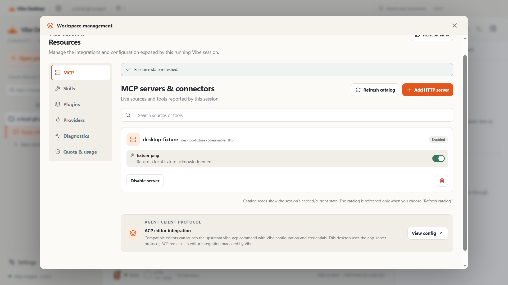
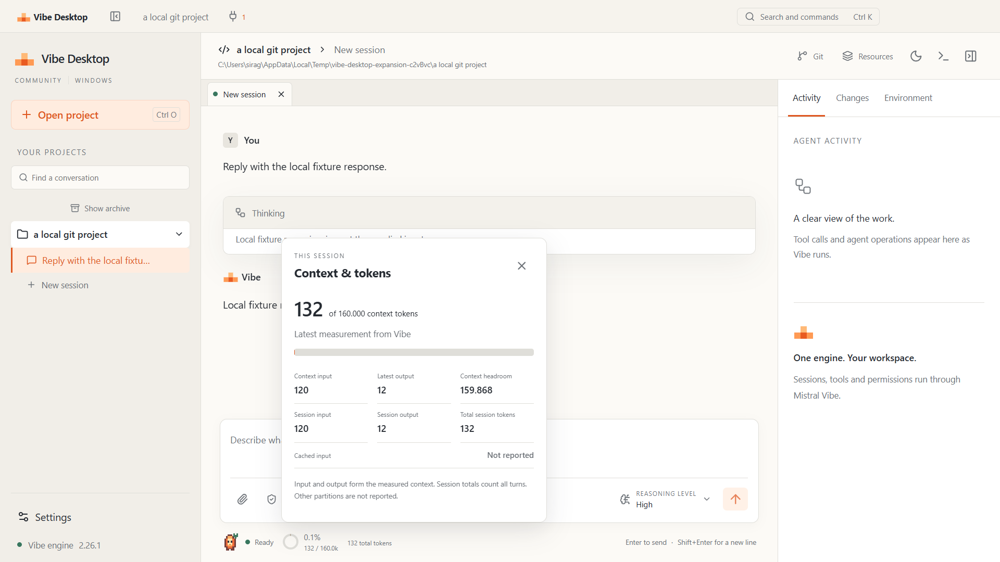
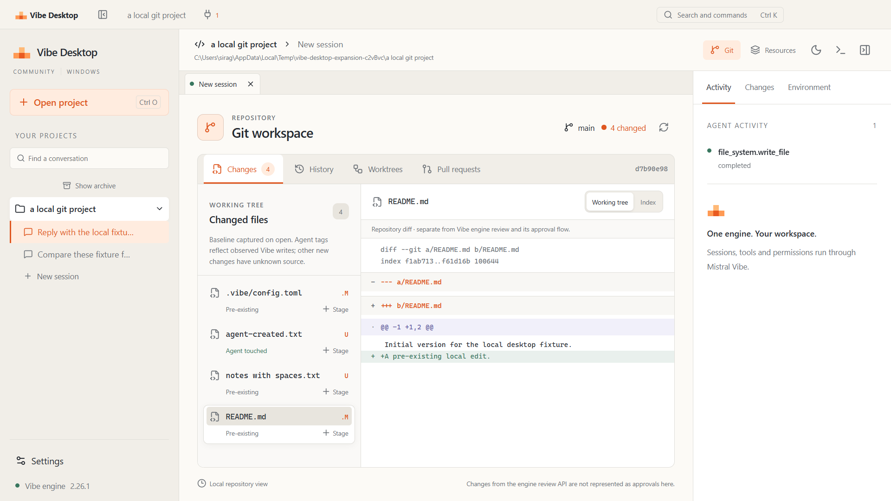

# Windows validation

This record covers Vibe Desktop 0.2 on 12–13 October 2026. All model responses used
for automated checks come from loopback fixtures. The official Vibe engine runs
the real tools, approvals, queues, storage and subagents against disposable
projects. Fixture token counts test the integration; they are not hosted-model
measurements.

## Build inputs

| Input               | Version                                    |
| ------------------- | ------------------------------------------ |
| Local host          | Windows 10 x64, build 19045                |
| Distribution target | Windows 11 x64                             |
| Node.js             | 24.19.0                                    |
| Electron            | 44.7.0                                     |
| Python              | 3.12.14 x64                                |
| Mistral Vibe        | 2.26.1                                     |
| Upstream commit     | `4ae5c5955da8e761318916bdb1a7f46f0b50c7d0` |
| PyInstaller         | 6.20.0                                     |

The complete Python environment is pinned in `requirements-backend.txt`.
`build-metadata.json` records that file's hash, canonical UTF-8/LF hashes of the
pinned upstream build inputs and the minimal desktop authentication helper.
Matching runtime notices are bundled under `licenses/`. Built-in plugin
manifests and skills omitted by the upstream spec are included and probed.

The current frozen app-server SHA-256 is
`75c8e8df8d483742051fa1ebf1d0d49cdc7602b362e8b90654b190f2f93a8a81`.
The executable includes the `--desktop-auth` controller bridge. Its isolated
status probe passed without making a hosted request; a real browser account
exchange remains an account-dependent check.

## Automated checks

The 56-test suite passes with no skips. It covers transport framing, callbacks,
public projection, Windows path aliases and executable lookup, selected-root
authorization, independent process owners, lease/metadata scope, GLM/custom
model identity, credential boundaries, browser-auth lifecycle and safe output,
Git operations and runtime measurements. Real-engine tests exercise streaming,
interruption, resume and an approved file write against loopback endpoints.
A 650-file dirty repository verifies the 500-path status cap; diff output is
bounded to 512 KiB and command output to 4 MiB.

TypeScript and production bundling pass. The initial renderer JavaScript is
approximately 430 kB (130 kB gzip); Git and workspace management load as separate
chunks. Secondary panel errors stay inside their boundary and leave the session
available. `npm audit` reports zero vulnerabilities in the complete locked tree.

The two Electron scenarios preserve the original regression coverage and add:

- Native titlebar overlay, theme, minimize/maximize/restore and minimum width.
- Both sidebar edges: drag to resize, collapse and reopen; left button toggle.
- Command palette, focus, IME input and session draft preservation.
- Configured Mistral/GLM/custom model discovery, reasoning selection and switching.
- Real concurrent session turns, native queue removal, pin/archive and restore.
- MCP HTTP discovery, tool/source controls, project-layer persistence and refresh,
  HTTP-source add/remove, installed-skill toggles and plugin reload.
- Runtime token/context diagnostics, reasoning controls and compact MCP status.
- Isolated quota-window permissions and fixed URLs. The test intercepts HTTPS
  navigation, so it checks the window boundary without reading a real account.
- Actual approved file creation, dirty-file attribution, diffs, stage/unstage,
  commit, history, read-only worktrees and a useful missing-remote state.
- Unified programmatic child spawn/wait, observed activity and child history.
- Image and text attachment selection, preview/removal, clipboard/drop and send;
  unsupported input validation and owned-backend crash/reconnect.

The executable probe confirms server identity/version, setup, trust, session
creation, a ready Unified runtime, packaged built-in resources and session stop,
with zero model calls. The credential-free probe returns typed `unauthorized`.
Upstream can emit `CancelledError` as stdio closes after a successful stop;
this is recorded without treating it as a failed conformance result.

## Performance evidence

The UI scenario samples the main process and every recursive descendant,
including renderer, GPU, utilities, console host and Python/native runtime.
It records startup-to-ready, combined working sets and idle CPU over the actual
elapsed sample interval. Working-set sums can count shared pages more than once;
CPU is expressed as a percentage of one core. Local measurements are observations,
not a benchmark promise. JSON records live in [performance](performance/).

The long-session fixture includes 650 source functions and repeated turns.
Messages use `content-visibility` with intrinsic layout space; the client does
not claim full transcript virtualization. Git and diff limits keep large
repository output bounded. The pool cap limits simultaneous backend ownership.

## Reproduce

```powershell
npm run build
npm test
./scripts/build-backend.ps1
$env:VIBE_TEST_SERVER = "$PWD/.runtime/backend/vibe-app-server/vibe-app-server.exe"
npm run test:ui
npm audit
npm run package
$env:VIBE_TEST_DESKTOP = "$PWD/out/win-unpacked/Vibe Desktop.exe"
npm run test:ui
```

The renderer stays sandboxed with context isolation and no Node integration.
An earlier host restriction required a user-authorized read/execute ACL only on
Electron's public binary directory. No disabled renderer sandbox is used.

## Interface evidence

Screenshots are generated from the real Electron window with disposable profiles
and labelled fixture responses. Finite screenshot animations are fast-forwarded
to their completed state. They include both themes, narrow layout, management,
MCP status, models, reasoning, context, approval, Git, subagents and attachments.

| Management                                               | Context                                                                 |
| -------------------------------------------------------- | ----------------------------------------------------------------------- |
|  |  |



## Distribution and remaining checks

The unsigned NSIS installer includes Electron and the official Python/native
runtime. Installed users do not need Python or uv. CI repeats tests before and
after packaging, then uploads the installer, SHA-256, screenshots, process-tree
measurements and backend manifests. No public release or merge is performed.

Hosted Windows UI tests allow one retry with a fresh disposable profile for
transient host failures. The packaged launcher waits for the renderer's initial
custom-scheme navigation before attaching through CDP and Node's inspector;
this avoids racing Playwright's first-navigation listener. The application and
its sandbox remain unchanged. Failed-attempt traces are retained
in the uploaded artifacts, including when a retry succeeds. Profile cleanup
waits for transient Chromium file locks with a bounded retry count.

A clean Windows 11 install/uninstall, DPI/snap/Mica behavior on that host, hosted
Mistral/GLM entitlement and model quality, live browser sign-in, connector OAuth,
registry network browsing and account quota rendering remain external checks.
PR creation has Git-service contract tests; no remote PR is created by the
product test. The repository PR used to review this change is separate.

The [capability matrix](capabilities.md) and [backlog](backlog.md) identify
remaining desktop work and the methods missing from Unified dispatch.

## Executed desktop gates

The original scenario passed with the frozen backend in 22.1 seconds; the
expanded scenario passed in 1.8 minutes. Both ran the actual Electron window,
with real Unified tools and disposable loopback endpoints. The frozen startup
sample reached ready in 3,317 ms, used 505.8 MiB of combined working sets across
six owned processes and observed 6.22% of one CPU core over 5.53 seconds. These
measurements include shared pages and the installed runtime process tree.

The packaged expansion scenario passed in 1.5 minutes, including graphical
provider addition, API-base leaf editing, model addition and a final check that
all owned processes exited. The packaged baseline scenario passed in 24.6
seconds. The latest packaged process sample reached ready in 3,385 ms and
recorded 528.7 MiB across six processes, with 0.28% of one core over 5.50 seconds.
This is a new-process launch with normal host caches, not a cold-OS benchmark.

Local installer: `Vibe-Desktop-0.2.0-x64-Setup.exe`, 164,821,071 bytes.
SHA-256: `833c8369604008f9a3d1f6bbf7a26afa86e4c303693f38b90e49c174a979f140`.
Authenticode status: `NotSigned`. `out/SHA256SUMS.txt` records the checksum.
The packaged UI scenarios execute the app produced by this final NSIS build.
