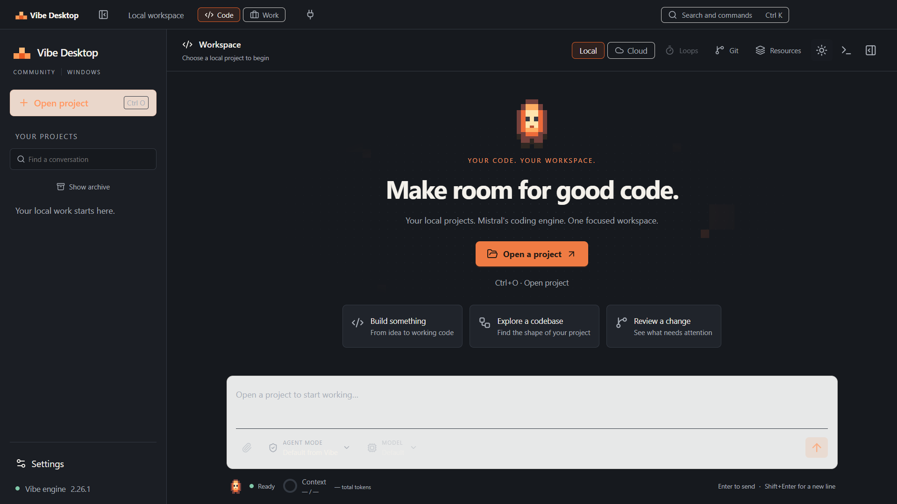
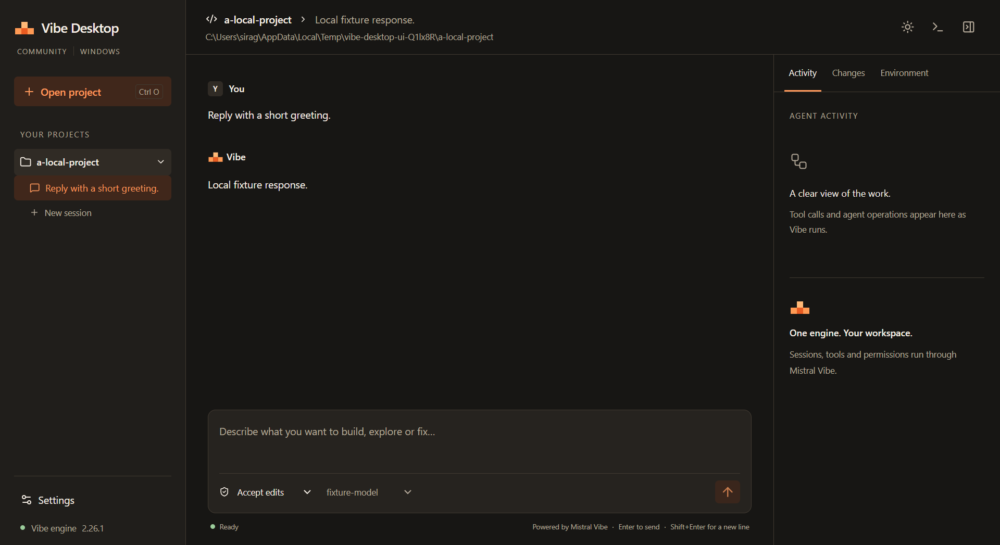

# Windows validation

This record describes the checks executed on 12 October 2026. The client runs
the published Mistral Vibe engine; the local model fixture is a test endpoint,
not a production backend or a simulated agent.

## Build inputs

| Input               | Version                                    |
| ------------------- | ------------------------------------------ |
| Local host          | Windows 10 x64, build 19045                |
| Distribution target | Windows 11 x64                             |
| Node.js             | 24.19.0                                    |
| Electron            | 44.7.0                                     |
| Python              | 3.12.14 x64                                |
| Mistral Vibe        | 2.26.1                                     |
| Upstream commit     | `4ae5c5955da8e761318916bdb1a7f46f0b50c7d0` |
| PyInstaller         | 6.20.0                                     |

The frozen executable SHA-256 is
`18ab843da50997265173a3885121f5772caf8c2aa16a0860ea15bc34215c28e9`.
Its `build-metadata.json` records the upstream source and hashes of the official
build entrypoint and hooks. Each support file is checked against the pinned
commit's Git blob and its SHA-256 over canonical UTF-8/LF bytes. Local Windows
checkouts and raw GitHub downloads therefore use the same verified input;
unexpected encoding and altered contents are rejected. The packaged `licenses/`
directory contains the runtime inventory and matching license texts.
The complete Python environment is pinned in `requirements-backend.txt`; its
hash is recorded in the build metadata. The build adds the built-in plugin
manifest and skills that the upstream 2.26.1 PyInstaller spec omits. The probe
requires those resources and rejects the resulting discovery error if they
are missing.

## Checks

`npm run build` passed TypeScript and production bundling. `npm test` passed all
24 transport, renderer and backend tests, with no skipped tests. The real
Electron integration test passed against both the installed and frozen
backend (26.4 seconds for the latest frozen run). `npm audit`
reported zero vulnerabilities in the locked npm dependency tree.
The same desktop workflow also passed against `out/win-unpacked/Vibe Desktop.exe`
and its bundled backend in 22.5 seconds, using disposable presentation and Vibe
profiles. This verifies the packaged executable as well as source launch.

The protocol probe ran both the installed wheel and the frozen executable. It
requires the expected server identity/version, successful setup, session listing
and trust inspection, a valid session, a ready Unified Runtime and a successful
session stop. It used an isolated Vibe home and made zero model calls. A separate
probe without provider credentials returned Vibe's typed `unauthorized` error.
Upstream emits a `CancelledError` diagnostic when stdio closes after the successful
stop response; this did not prevent a clean probe result.

The automated suite covers fragmented UTF-8, frame limits, request correlation,
callback receipt acknowledgement, process failure, project authorization and
credential ownership. Real engine integration exercises streaming, interruption,
stop/restart/resume and a second turn against a loopback provider. Callback
approval, denial and question payloads have wire-contract tests. An additional
real-engine test requests `file_system.write_file` in Ask mode, requires the
authentic approval callback, then verifies the exact file and completed
`file_write` effect. Hosted model requests have not been exercised.

That same test verifies that the default Unified Harness returns
`method_not_found` for `review/state` and `review/turnDiff`. These procedures
exist in the legacy Python handler, while the current default adapter does not
dispatch them. The Changes panel presents their availability explicitly.
Windows fixture paths are canonicalized to support the runner's `RUNNER~1`
temporary-directory alias. A junction regression check verifies that the
picker authorizes the canonical target while raw aliases remain rejected.
Windows startup also pins `NODEFAULTCURRENTDIRECTORYINEXEPATH=1` in the backend
child's environment. This prevents a GitPython environment mutation from racing
with Vibe's shell environment snapshot; regression checks cover case-insensitive
key handling and preservation of the parent environment.
The original exception was reproduced with concurrent GitPython patches and
Vibe snapshots. The same stress check completed without errors with the flag
held for the child process's lifetime.

The renderer tests cover incremental patches, duplicate and missing events,
partial snapshots, context handoff, multi-select questions and custom answers.
The desktop test launches the actual Electron window with the frozen backend,
checks sandbox/context-isolation/Node settings, and exercises project trust,
streaming, session switching, resume and shell output. It terminates only that
window's owned app-server process, reconnects, resumes saved history and verifies
that the unsent draft survived. The minimum window size is checked for horizontal
overflow.

Reproduce the checks after [installing the source dependencies](../README.md):

```powershell
npm run build
npm test
./scripts/build-backend.ps1
$env:VIBE_TEST_SERVER = "$PWD/.runtime/backend/vibe-app-server/vibe-app-server.exe"
npm run test:ui
npm audit
npm run package
$env:VIBE_TEST_DESKTOP = "$PWD/out/win-unpacked/Vibe Desktop.exe"
npm run test:ui
```

The first Electron launch was blocked by this host's additional Codex process
sandbox. A user-authorized read/execute ACL was added only to Electron's public
binary directory. The GUI tests run outside that host restriction and explicitly
assert that Electron's renderer sandbox remains enabled. No `--no-sandbox` flag
or disabled web security is used.

## Interface evidence

These are actual desktop captures produced by the UI test. The session screenshot
contains the labelled local fixture response; it is not evidence of a hosted
Mistral request. The [design record](design.md) links the earlier layout preview
and the Mistral references used to evaluate the implemented interface.

| Light                                           | Dark                                          |
| ----------------------------------------------- | --------------------------------------------- |
|  |  |



## Distribution

The Windows package includes Electron and the frozen upstream Python/native
runtime. Python and uv are build tools, not end-user installation requirements.
The NSIS build is local and unsigned; no release is published by the build
workflow. CI uploads the installer, its SHA-256, screenshots and backend
manifests as a build artifact.

Local artifact: `Vibe-Desktop-0.1.0-x64-Setup.exe`, 164,646,584 bytes.
SHA-256: `1b4c26de5cbea75681fe0cb7427a5aee5488ee30cca14e5de054ad38f5e3df02`.
`Get-AuthenticodeSignature` reports `NotSigned`. The matching checksum is saved
in `out/SHA256SUMS.txt`; CI generates its own checksum for its artifact.

Interactive installation and uninstall on a clean Windows 11 machine remain to
be executed. This Windows 10 host establishes runtime and packaging feasibility,
not that clean-machine result. Hosted Mistral credentials, account entitlement
and paid model conformance also remain untested. The next increments and their
acceptance criteria are recorded in the [backlog](backlog.md).
